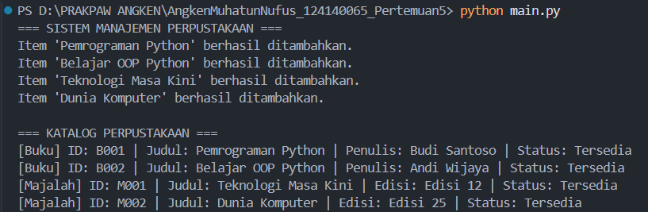
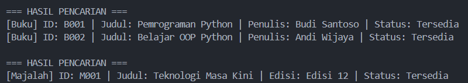
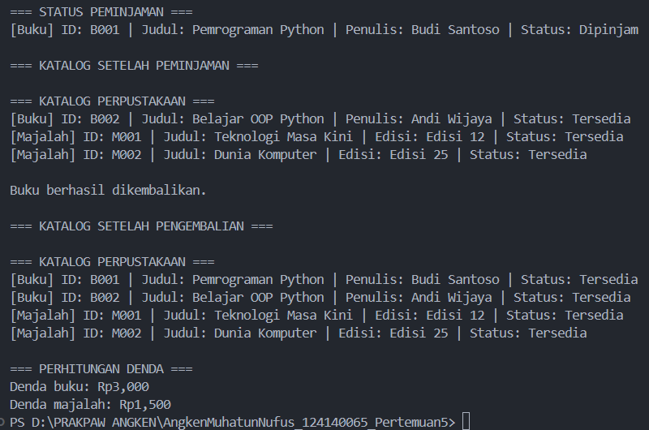

- Nama: Angken Muhatun Nufus
- NIM: 124140065
- Kelas: RA

## Deskripsi Program

Program ini merupakan sistem manajemen perpustakaan sederhana
yang dibuat menggunakan bahasa Python dengan menerapkan
konsep Object Oriented Programming (OOP).

Program dapat menambahkan buku dan majalah, menampilkan
katalog item yang tersedia, mencari item berdasarkan ID
atau judul, serta menampilkan status peminjaman.

## Konsep OOP yang Digunakan

1. Class
   Digunakan untuk membuat LibraryItem, Book, Magazine,
   dan Library.

2. Inheritance
   Class Book dan Magazine mewarisi class LibraryItem.

3. Encapsulation
   Menggunakan atribut protected dan private untuk
   melindungi data penting, seperti __koleksi dan
   __dipinjam.

4. Polymorphism
   Method get_detail() dan hitung_denda() memiliki
   implementasi berbeda pada class Book dan Magazine.

5. Abstract Class
   LibraryItem menggunakan ABC dan abstractmethod
   sebagai dasar class turunannya.

6. Property Decorator
   Menggunakan @property untuk mengakses judul dan
   status peminjaman item.

## Struktur File

- library_item.py : Berisi abstract class, Book, dan Magazine.
- library.py : Mengelola koleksi perpustakaan.
- main.py : Menjalankan program.

## Cara Menjalankan Program

1. Pastikan Python sudah terinstal.
2. Buka folder project di VS Code.
3. Buka terminal.
4. Jalankan perintah berikut:

   python main.py

## Screenshot Pengujian

### 1. Penambahan Item dan Katalog

### 2. Pencarian Item

### 3. Status Peminjaman

