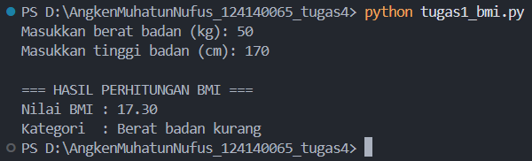
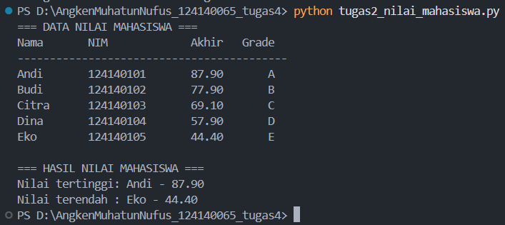
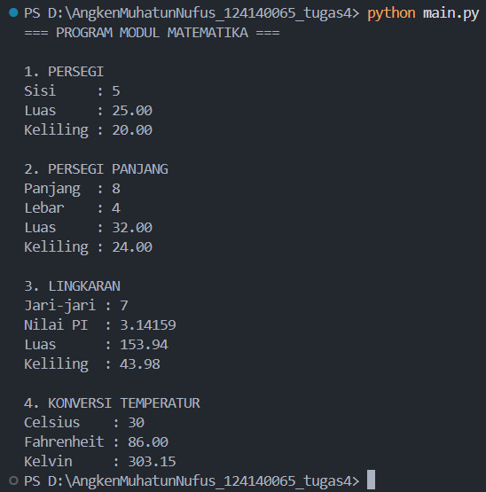

# Praktikum Pemrograman Python - Pertemuan 4

## Identitas Mahasiswa

- Nama: Angken Muhatun Nufus
- NIM: 124140065
- Kelas: RA

## Deskripsi Program

### 1. Program Penghitung BMI

Program ini digunakan untuk menghitung nilai BMI berdasarkan berat dan tinggi badan. Pengguna memasukkan berat badan dalam kilogram dan tinggi badan dalam sentimeter. Selanjutnya program menghitung BMI dan menentukan kategori berat badan menggunakan percabangan if-elif-else.

### 2. Program Pengelolaan Nilai Mahasiswa

Program ini menggunakan list dan dictionary untuk menyimpan data lima mahasiswa. Setiap mahasiswa memiliki nama, NIM, nilai UTS, nilai UAS, dan nilai tugas. Nilai akhir dihitung berdasarkan bobot 30% UTS, 40% UAS, dan 30% tugas. Program juga menentukan grade serta mencari nilai tertinggi dan terendah.

### 3. Modul Matematika

Program ini menggunakan dua file Python, yaitu math_operations.py dan main.py. File math_operations.py berisi fungsi untuk menghitung luas dan keliling persegi, persegi panjang, dan lingkaran. Selain itu, terdapat fungsi konversi suhu Celsius ke Fahrenheit dan Kelvin.

File main.py digunakan untuk mengimpor dan menjalankan seluruh fungsi yang telah dibuat pada modul matematika.

## Cara Menjalankan Program

Buka folder proyek menggunakan Visual Studio Code, kemudian buka terminal.

### Soal 1 - BMI

```bash
python tugas1_bmi.py
```

### Soal 2 - Nilai Mahasiswa

```bash
python tugas2_nilai_mahasiswa.py
```

### Soal 3 - Modul Matematika

```bash
python main.py
```

Pastikan semua file Python berada dalam satu folder yang sama.

## Dokumentasi Hasil Program

### 1. Hasil Program BMI

Masukkan screenshot hasil eksekusi program BMI di bawah ini.



### 2. Hasil Program Nilai Mahasiswa

Masukkan screenshot hasil eksekusi program nilai mahasiswa di bawah ini.



### 3. Hasil Program Modul Matematika

Masukkan screenshot hasil eksekusi program modul matematika di bawah ini.


